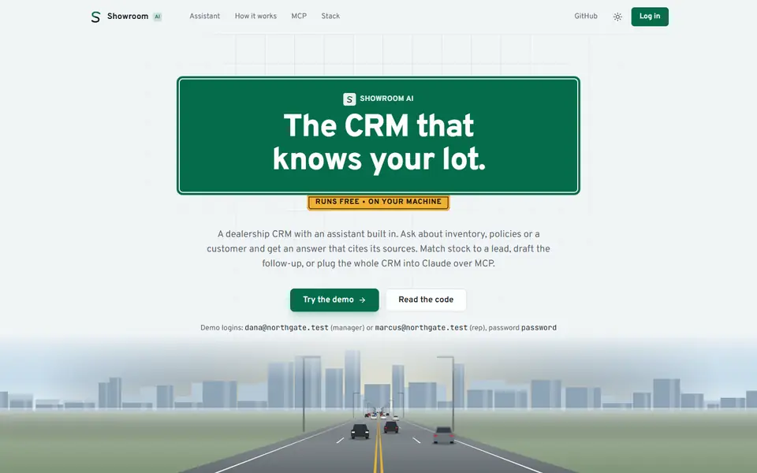
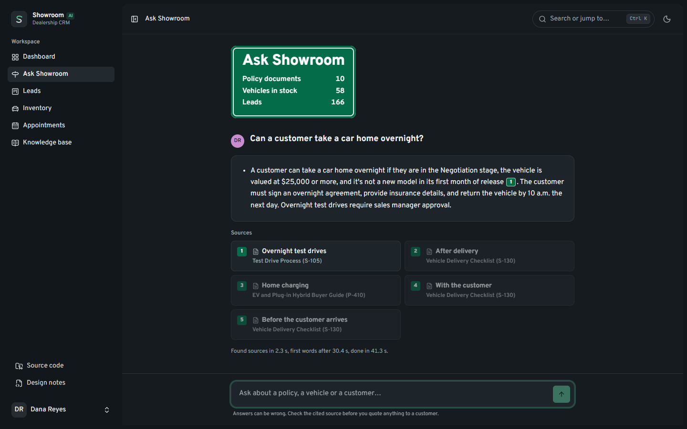
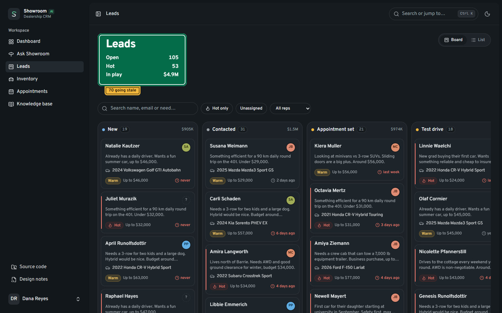
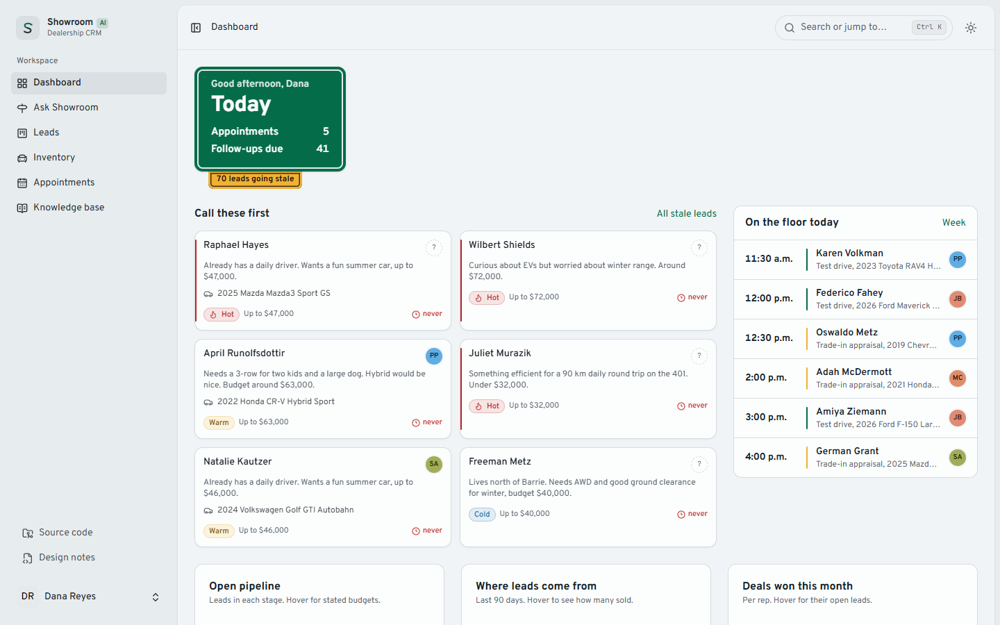
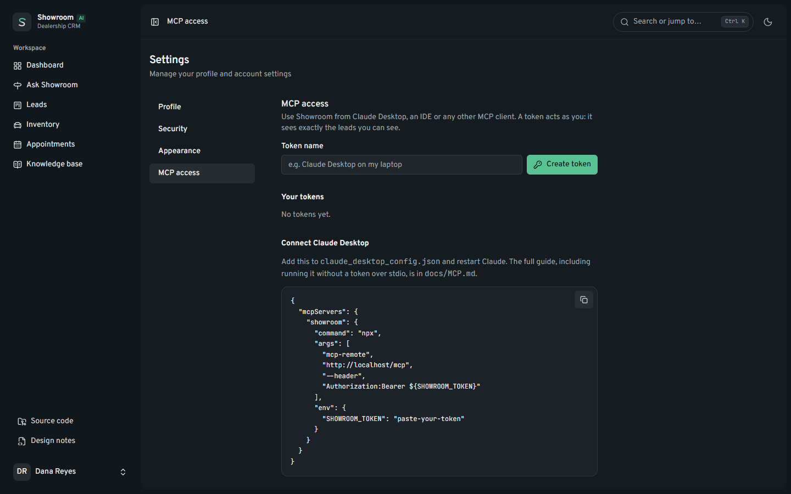
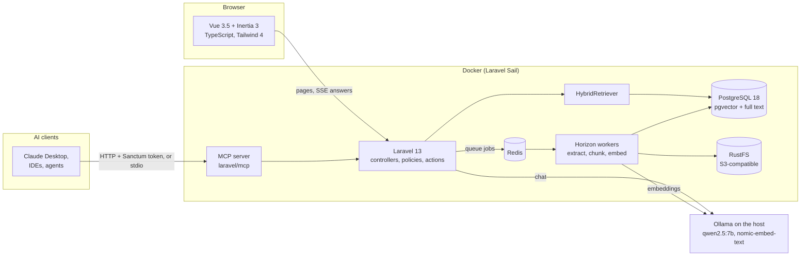
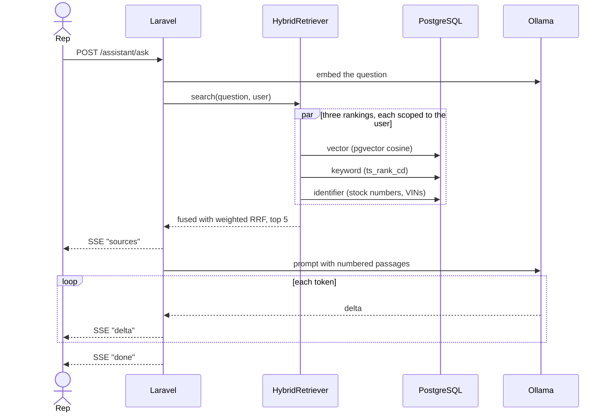

# Showroom AI

A CRM for car dealerships with an AI sales assistant built in. It answers questions about your
inventory, policies and customers with every claim cited, matches stock to a lead, drafts the
follow-up email, and exposes the whole CRM to AI clients like Claude Desktop through an MCP
server.

Everything runs on one machine and costs nothing: local models through Ollama, PostgreSQL with
pgvector, and S3-compatible storage in Docker. No API keys, no cloud account.

<picture>
  <source media="(prefers-color-scheme: dark)" srcset="docs/screenshots/hero-dark.webp">
  
</picture>

## Demo


A 98-second walkthrough, signed in as a sales rep. It covers the CRM (dashboard, leads, a customer's
timeline, stock, policy documents), then the assistant: answers with numbered citations,
retrieval limited to the rep's own leads, a phone number masked as `[phone]` before it reaches the
model, stock matched to a lead, and a follow-up email that stays a draft until a person sends it.

## What's in it

|                                                                                                                                                                                                      |                                                                             |
| ---------------------------------------------------------------------------------------------------------------------------------------------------------------------------------------------------- | --------------------------------------------------------------------------- |
| **Ask Showroom.** Questions about policies, stock or a customer, answered from your own data with numbered citations that open the exact passage. Streams token by token.                            |  |
| **Leads.** A board you drag between stages, a list with filters, and a timeline for each lead. On a lead's page the assistant shortlists matching stock and drafts the next email from the timeline. |                           |
| **The floor today.** Who to call first, today's appointments, the open pipeline and where leads come from. A rep sees their own day, a manager sees everyone's.                                      |                       |
| **MCP access.** Each person creates their own token, which only opens the MCP endpoint. The page hands you a ready-to-paste Claude Desktop config.                                                   |                      |

There's also an inventory with filters, an appointments calendar, a knowledge base for policy
documents, light and dark themes, and a ⌘K command palette.

## Architecture



One rule holds the design together: **there is one place that decides who can see what.** The
web pages, the assistant's retrieval and every MCP tool go through the same scoped queries and
policies, so the assistant can never show a rep a lead they couldn't open themselves.

### How a question gets answered



Indexing runs on the queue. An uploaded document is stored in RustFS, then an `IndexDocument`
job extracts the text, splits it along its headings and embeds each passage. Vehicles, leads
and activity notes are re-indexed by an `IndexSource` job whenever they change. Phone numbers and emails are masked before any text is
embedded or sent to a model.

## Retrieval, measured

`php artisan showroom:eval` asks 35 questions with known answers (7 of them by stock number or
VIN) and scores where the right passage lands. The full table is in
[evals/results.md](evals/results.md).

| Search  | hit@1 | hit@5 |  MRR |
| ------- | ----: | ----: | ---: |
| vector  |  0.83 |  0.94 | 0.87 |
| keyword |  0.60 |  0.74 | 0.68 |
| hybrid  |  0.80 |  0.97 | 0.86 |

Equal-weight fusion first came out _worse_ than vector search alone. The eval showed why: exact
codes were being found by the keyword search and then out-voted. Adding a third ranking for
identifiers and halving the keyword weight fixed it. The reasoning is in
[ADR-003](docs/adr/003-hybrid-retrieval.md).

## Running it locally

You need Docker, Node 22+ and [Ollama](https://ollama.com). Setup takes about ten minutes, most
of it downloading models and images. [docs/ONBOARDING.md](docs/ONBOARDING.md) has the longer
version with troubleshooting.

```bash
ollama pull nomic-embed-text
ollama pull qwen2.5:7b
```

```bash
cp .env.example .env
docker run --rm -v "$(pwd):/app" -w /app composer:2 composer install --ignore-platform-reqs
./vendor/bin/sail up -d
./vendor/bin/sail artisan key:generate
./vendor/bin/sail artisan migrate --seed
./vendor/bin/sail artisan showroom:storage-init
./vendor/bin/sail artisan showroom:index   # makes the CRM and documents searchable, about a minute
npm install && npm run dev
```

Open http://localhost and log in with one of the demo accounts. The password is `password` for
all of them.

| Login                   | Role            | Sees                                |
| ----------------------- | --------------- | ----------------------------------- |
| `dana@northgate.test`   | Sales manager   | The whole floor, plus a leaderboard |
| `marcus@northgate.test` | Sales rep       | Only his own leads                  |
| `ethan@northgate.test`  | BDC coordinator | All leads, to book appointments     |

Horizon is at http://localhost/horizon and the RustFS console at http://localhost:9001. If
your GPU driver is too old for Ollama, set `OLLAMA_NUM_GPU=0` in `.env` to run on the CPU.
Answers then take 20 to 60 seconds instead of a few.

To connect Claude Desktop, see [docs/MCP.md](docs/MCP.md).

## Quality gate

```bash
npm run ci
```

Pint, Larastan (level 7), Pest, ESLint, Prettier, vue-tsc and a production build. GitHub
Actions isn't available on this account, so the gate runs locally before every merge. Tests
never call a real model: embeddings and agents are faked.

## Docs

| Doc                                   | What it's for                                                   |
| ------------------------------------- | --------------------------------------------------------------- |
| [DESIGN.md](docs/DESIGN.md)           | The original plan: scope, domain model, RAG and MCP design      |
| [docs/adr/](docs/adr/)                | Architecture decisions, one per file, with the trade-offs       |
| [MCP.md](docs/MCP.md)                 | Connecting AI clients, and the security model                   |
| [AI_WORKFLOW.md](AI_WORKFLOW.md)      | How a team should use AI assistants on a codebase like this one |
| [ONBOARDING.md](docs/ONBOARDING.md)   | First day: setup, a tour of the code, and a first ticket        |
| [CONTRIBUTING.md](CONTRIBUTING.md)    | Branches, commits, PRs and the quality gate                     |
| [CODE_REVIEW.md](docs/CODE_REVIEW.md) | What I look for in review                                       |
| [ROADMAP.md](ROADMAP.md)              | What's next, planned the way a team plans a quarter             |
| [DEMO.md](docs/DEMO.md)               | A two-minute demo script                                        |

## Known limits

- **A 7B model is a 7B model.** It's good at reading a passage and citing it, and weak at
  arithmetic across passages ("which of these is under $30,000?"). That's why vehicle matching
  filters on price in SQL first and only asks the model to choose and explain.
- **CPU speed.** On the CPU, an answer takes 20 to 60 seconds. On a recent GPU it's a few
  seconds. The UI streams, so the first words show up long before the end.
- **Demo data only.** The dealership, people and policies are made up.

## Stack

Laravel 13 · PHP 8.4 · Inertia 3 · Vue 3.5 + TypeScript · Tailwind 4 · PostgreSQL 18 +
pgvector · Redis + Horizon · RustFS · Ollama · Laravel AI SDK · Laravel MCP · Sanctum · Pest ·
Larastan
